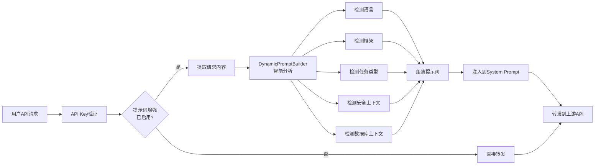

# 智能动态提示词注入系统 - 设计方案

## 1. 背景与目标

### 1.1 问题陈述

用户反馈OpenAI 6系模型存在以下问题：
- 频繁出现幻觉（hallucination）
- 过度防御，给出过多不必要的安全警告
- 开发效率低，浪费开发时间

### 1.2 参考案例

"意见中转站"（api.aijws.com）的API服务表现优异：
- 开发任务95%一次成功
- 每次输入token约10万
- 模型表现智能且可靠

### 1.3 解决方案目标

设计一个**完全自动化、智能动态**的提示词注入系统：
- ✅ 用户无需手动编写提示词
- ✅ 自动适应不同编程语言和框架
- ✅ 根据任务类型动态调整注入内容
- ✅ 解决跨语言/跨项目使用问题
- ✅ 提供10,000-15,000 tokens的专业指导
- ✅ 支持Prompt Caching优化成本

---

## 2. 系统架构

### 2.1 核心流程



### 2.2 组件说明

#### 核心组件

1. **DynamicPromptBuilder** (`dynamic_prompt_builder.go`)
   - 智能内容分析器
   - 自动检测技术栈和上下文
   - 动态组装提示词

2. **PromptTemplates** (`prompt_templates.go`)
   - 提示词模板库（10K-15K tokens）
   - 涵盖多种语言、框架、任务类型
   - 包含安全和数据库最佳实践

3. **PromptInjection** (`prompt_injection.go`)
   - 提示词注入执行器
   - 支持OpenAI、Anthropic、Gemini格式
   - 优雅处理现有system prompt

---

## 3. 智能检测机制

### 3.1 编程语言检测

通过正则表达式和关键词匹配，自动识别12种主流编程语言：

| 语言 | 检测特征 | 优先级 |
|------|----------|--------|
| **Go** | `func`, `package`, `goroutine`, `.go` | 高 |
| **Java** | `class`, `public class`, `@Override`, `.java` | 高 |
| **Python** | `def`, `import`, `self.`, `.py` | 高 |
| **JavaScript** | `function`, `const`, `=>`, `.js`, `node` | 高 |
| **TypeScript** | `interface`, `type`, `: string`, `.ts` | 高 |
| **Rust** | `fn`, `let mut`, `impl`, `.rs` | 中 |
| **C++** | `#include`, `std::`, `namespace`, `.cpp` | 中 |
| **C#** | `using System`, `namespace`, `.cs` | 中 |
| **PHP** | `<?php`, `function`, `$variable`, `.php` | 中 |
| **Ruby** | `def`, `end`, `require`, `.rb` | 低 |
| **Swift** | `func`, `var`, `let`, `.swift` | 低 |
| **Kotlin** | `fun`, `val`, `var`, `.kt` | 低 |

**检测算法**：
```go
// 对每种语言的所有模式进行匹配
// 累积匹配分数
// 返回得分最高的语言
func detectLanguage(requestLower, requestOriginal string) string
```

### 3.2 框架检测

识别主流开发框架：

| 框架 | 技术栈 | 检测关键词 |
|------|--------|------------|
| **React** | Frontend | `react`, `useState`, `useEffect`, `jsx` |
| **Vue** | Frontend | `vue`, `v-if`, `v-for`, `<template>` |
| **Angular** | Frontend | `angular`, `@Component`, `ngOnInit` |
| **Spring** | Java Backend | `@SpringBootApplication`, `@RestController` |
| **Django** | Python Backend | `django`, `models.Model`, `views.py` |
| **Flask** | Python Backend | `flask`, `@app.route` |
| **Express** | Node.js Backend | `express`, `app.get`, `req.body` |
| **Gin** | Go Backend | `gin`, `gin.Default()`, `c.JSON` |
| **FastAPI** | Python Backend | `fastapi`, `@app.get` |
| **Rails** | Ruby Backend | `rails`, `ActiveRecord` |
| **Laravel** | PHP Backend | `laravel`, `Eloquent` |

### 3.3 任务类型识别

自动判断开发任务类型（支持中英文）：

| 任务类型 | 中文关键词 | 英文关键词 |
|----------|------------|------------|
| **重构** | 重构、优化代码 | refactor, improve code, clean up |
| **修复Bug** | 错误、修复、问题 | bug, fix, error, issue |
| **新功能** | 新增、实现、添加 | add, implement, create, feature |
| **测试** | 测试、单元测试 | test, unit test, mock |
| **API开发** | 接口、API、路由 | api, endpoint, route, rest |
| **数据库** | 数据库、SQL、查询 | database, sql, query, migration |
| **UI开发** | 界面、布局、组件 | ui, layout, component, style |
| **性能优化** | 性能、优化、慢 | performance, optimize, slow, cache |

### 3.4 上下文检测

#### 安全敏感上下文
检测涉及安全的操作，自动加强防护指导：
- 关键词：`auth`, `login`, `password`, `token`, `jwt`, `session`, `permission`, `认证`, `登录`, `密码`, `权限`
- 触发时：自动注入2000 tokens的安全最佳实践

#### 数据库上下文
检测数据库操作，自动加入防注入指导：
- 关键词：`sql`, `database`, `query`, `select`, `insert`, `update`, `数据库`, `查询`, `orm`
- 触发时：自动注入1000 tokens的数据库安全规范

---

## 4. 提示词模板体系

### 4.1 基础层（5000 tokens）- 永远注入

提供语言无关的通用指导：

#### 核心原则
1. **精确性优于猜测**
   - 不确定时明确说明
   - 禁止幻觉（hallucination）
   - 验证后再使用API、函数名

2. **行动导向的开发**
   - 提供完整可用的代码
   - 不使用占位符注释
   - 生产级代码质量

3. **平衡的安全意识**
   - 默认实施安全最佳实践
   - 不过度警告常规开发任务
   - 尊重开发者的专业能力

4. **项目感知的上下文**
   - 遵循现有代码模式
   - 重用现有工具和库
   - 匹配代码风格

5. **高效问题解决**
   - 解决实际问题，不过度工程化
   - 简单直接的解决方案
   - 不添加未要求的功能

#### 代码质量标准
- 完整性：提供全功能代码，包含错误处理
- 可读性：清晰命名，遵循语言规范
- 可测试性：清晰接口，考虑边界情况

#### 沟通风格
- 直接简洁：先给方案，不冗余
- 展示而非讲述：用代码示例演示
- 渐进式披露：核心方案优先

#### 开发工作流
- 理解优先：先读现有代码
- 增量开发：每步保持可工作状态
- 错误恢复：分析失败原因，调整方案

### 4.2 语言层（2000-3000 tokens）- 按检测结果注入

#### Go语言指导
```
# Go Language Guidelines

## 惯用法和最佳实践
- 使用gofmt格式化
- 遵循effective Go
- 组合优于继承
- 明确处理错误
- 使用defer清理资源
- 利用goroutine和channel实现并发

## 常见模式
- 构造函数：NewTypeName() (*TypeName, error)
- 错误包装：fmt.Errorf("操作失败: %w", err)
- 表驱动测试
- 结构体嵌入实现组合

## 错误处理
- 返回错误而非panic
- 立即检查错误
- 使用errors.Is()和errors.As()

## 并发
- 通过通信共享内存
- 使用context取消
- 避免goroutine泄漏
```

#### Python语言指导
```
# Python Language Guidelines

## 风格和约定
- 遵循PEP 8
- 使用类型提示（Python 3.9+）
- 使用dataclass处理简单数据
- 使用f-string格式化字符串

## Pythonic模式
- 列表推导式
- 上下文管理器（with语句）
- 生成器提高内存效率
- 拥抱鸭子类型

## 错误处理
- 抛出具体异常
- 使用try/except/finally
- 记录异常后再抛出
```

类似地提供Java、JavaScript、TypeScript等语言的专业指导。

### 4.3 框架层（2000-3000 tokens）- 按检测结果注入

#### Gin框架指导
```
# Gin Framework Guidelines

## 路由处理
- 定义路由：router.GET, router.POST
- 分组路由：v1 := router.Group("/api/v1")
- 使用中间件
- 返回JSON：c.JSON(http.StatusOK, response)
- 绑定请求：c.ShouldBindJSON(&data)

## 中间件
- 实现：func(c *gin.Context)
- 调用c.Next()继续链或c.Abort()停止
- 上下文传值：c.Set/c.Get

## 错误处理
- 使用c.JSON返回错误
- 统一错误结构
- 记录错误

## 最佳实践
- 高效使用gin.Context
- 使用struct tag验证：binding:"required,email"
- 使用c.Param()获取路径参数
```

#### React框架指导
```
# React Framework Guidelines

## 组件设计
- 使用函数组件和Hooks
- 保持组件小而专注
- 提取自定义Hook
- 使用prop解构

## Hooks最佳实践
- useState管理组件状态
- useEffect处理副作用
- useMemo优化计算
- useCallback优化函数
- 自定义Hook以"use"开头

## 状态管理
- 状态提升到共同祖先
- 使用Context API管理全局状态
- 复杂状态考虑Redux Toolkit

## 性能
- React.memo避免重渲染
- 懒加载组件
- 虚拟化长列表
```

### 4.4 任务层（1000-2000 tokens）- 按检测结果注入

#### Bug修复指导
```
# Bug Fixing Guidelines

## 调查
- 一致性复现bug
- 识别根本原因，不只是症状
- 检查最近的改动
- 仔细审查错误信息和堆栈跟踪

## 修复策略
- 先编写暴露bug的测试
- 最小化修改
- 确保不破坏其他功能
- 考虑边界情况

## 验证
- 运行所有相关测试
- 在实际环境手动测试
- 检查相关代码中的类似bug
- 在提交信息中记录修复
```

#### API开发指导
```
# API Development Guidelines

## REST API设计
- 使用正确的HTTP方法
- 使用复数名词表示资源：/users, /products
- 正确使用HTTP状态码
- API版本控制：/v1/users
- 查询参数：?page=1&limit=10&sort=name

## 请求/响应
- 默认使用JSON
- 验证所有输入
- 统一错误格式
- 返回相关元数据
- 正确的content-type头

## 安全
- 实施认证（JWT、OAuth2、API密钥）
- 授权资源访问
- 验证和清理所有输入
- 生产环境使用HTTPS
- 实施速率限制
```

#### 性能优化指导
```
# Performance Optimization Guidelines

## 先测量
- 优化前先性能分析
- 用数据识别实际瓶颈
- 设置性能目标
- 测量改进后的效果

## 常见优化
- 数据库查询使用索引
- 实施缓存（Redis、内存）
- 懒加载数据和组件
- 批量操作代替循环
- 使用高效的算法和数据结构
- 优化数据库查询（避免N+1问题）
- 静态资源使用CDN

## 代码级优化
- 避免过早优化
- 使用合适的数据结构
- 热路径中最小化对象创建
- 大数据使用流式处理
- 大数据集实施分页

## 监控
- 添加性能指标
- 记录慢操作
- 设置性能下降告警
- 生产环境持续监控
```

### 4.5 安全层（2000 tokens）- 安全上下文时注入

```
# Security Best Practices

## 认证与授权
- 使用成熟的库（不自己实现加密）
- 使用bcrypt、argon2或scrypt哈希密码
- 实施安全的会话管理
- JWT使用适当的过期和刷新token
- 每个保护操作验证权限
- 实施基于角色的访问控制（RBAC）

## 输入验证
- 验证所有用户输入（客户端和服务端）
- 优先使用白名单而非黑名单
- 清理输入防止注入攻击
- 实施适当的错误消息（不泄露敏感信息）
- 验证文件上传（类型、大小、内容）

## 注入防护
- SQL：使用参数化查询/预编译语句
- NoSQL：使用正确的转义和验证
- 命令：避免shell执行，直接使用API
- XSS：转义输出，使用内容安全策略
- CSRF：状态改变操作使用CSRF token

## 数据保护
- 静态和传输中加密敏感数据
- 所有通信使用HTTPS/TLS
- 密钥存储在环境变量或密钥管理器
- 永远不记录敏感信息（密码、token、PII）
- 实施适当的密钥管理

## API安全
- 使用API密钥或OAuth2认证
- 实施速率限制防止滥用
- 验证Content-Type头
- 适当使用CORS策略
- 记录安全事件用于审计

## OWASP Top 10常见漏洞
1. 注入（SQL、NoSQL、命令）
2. 身份认证失效
3. 敏感数据泄露
4. XML外部实体（XXE）
5. 访问控制失效
6. 安全配置错误
7. 跨站脚本（XSS）
8. 不安全的反序列化
9. 使用已知漏洞的组件
10. 日志记录和监控不足
```

### 4.6 数据库层（1000 tokens）- 数据库上下文时注入

```
# Database Best Practices

## 查询优化
- WHERE、JOIN、ORDER BY子句的列上使用索引
- 避免SELECT *，明确指定列
- 大结果集使用LIMIT
- 面向用户的查询实施分页
- 使用EXPLAIN分析查询性能

## SQL注入防护
- 始终使用参数化查询/预编译语句
- 永远不要将用户输入拼接到SQL字符串
- 正确示例：db.Query("SELECT * FROM users WHERE id = ?", userID)
- 错误示例：db.Query("SELECT * FROM users WHERE id = " + userID)

## 事务管理
- 多步操作使用事务
- 保持事务简短避免锁定问题
- 始终提交或回滚（Go中使用defer）
- 理解隔离级别及其权衡

## 连接管理
- 使用连接池
- 设置适当的池大小限制
- 优雅处理连接错误
- 正确关闭连接和语句
- 使用context实现超时和取消

## Schema设计
- 使用适当的数据类型
- 定义外键保证引用完整性
- 策略性添加索引（平衡读写性能）
- 规范化减少冗余，需要时反规范化提升性能
- 使用迁移管理schema变更

## ORM最佳实践
- 理解ORM生成的SQL
- 避免N+1查询问题（使用eager loading/joins）
- 复杂操作使用原生查询
- 在应用层验证数据
- 正确处理ORM特定的事务
```

---

## 5. 实施方案

### 5.1 数据库Schema

在 `api_key` 表添加字段：

```go
// backend/ent/schema/api_key.go
field.Bool("prompt_injection_enabled").
    Default(false).
    Comment("Enable intelligent prompt injection for this API key"),
```

**注意**：不需要 `prompt_injection_content` 字段，因为内容是动态生成的。

### 5.2 核心代码集成

#### 步骤1：在Gateway Handler中集成

修改 [`backend/internal/handler/gateway_handler_chat_completions.go`](D:\sub2api\sub2api-jrw\backend\internal\handler\gateway_handler_chat_completions.go)：

```go
// 在 forwardBody := body 之后添加（约第299行）

// 智能动态提示词注入
if apiKey.PromptInjectionEnabled {
    // 创建动态提示词构建器
    builder := service.NewDynamicPromptBuilder()
    
    // 分析请求内容，检测语言、框架、任务类型等
    builder.AnalyzeRequest(string(body))
    
    // 构建完整的提示词（10K-15K tokens）
    dynamicPrompt := builder.Build()
    
    // 注入到请求中
    forwardBody, err = service.InjectPromptIfEnabled(
        &service.APIKey{
            PromptInjectionEnabled: true,
            PromptInjectionContent: dynamicPrompt,
        },
        forwardBody,
        account.Platform,
    )
    if err != nil {
        reqLog.Warn("gateway.cc.prompt_injection_failed", zap.Error(err))
        // 注入失败不阻塞请求，继续使用原body
    } else {
        reqLog.Debug("gateway.cc.prompt_injected",
            zap.Int("prompt_length", len(dynamicPrompt)),
            zap.String("detected_language", builder.detectedLanguage),
            zap.String("detected_framework", builder.detectedFramework),
            zap.String("task_type", builder.taskType),
        )
    }
}
```

#### 步骤2：导出字段用于日志

修改 [`backend/internal/service/dynamic_prompt_builder.go`](D:\sub2api\sub2api-jrw\backend\internal\service\dynamic_prompt_builder.go)：

```go
// 将私有字段改为导出字段，以便在handler中记录日志
type DynamicPromptBuilder struct {
    basePrompt        string
    DetectedLanguage  string  // 导出
    DetectedFramework string  // 导出
    TaskType          string  // 导出
    SecurityContext   bool    // 导出
    DatabaseContext   bool    // 导出
}
```

### 5.3 前端UI实现

修改 [`frontend/src/views/user/KeysView.vue`](D:\sub2api\sub2api-jrw\frontend\src\views\user\KeysView.vue)：

```vue
<!-- 在API Key表单中添加 -->
<el-form-item label="智能提示词增强">
  <el-switch 
    v-model="formData.prompt_injection_enabled"
    active-text="启用"
    inactive-text="关闭"
  />
  <div class="el-form-item__hint" style="margin-top: 8px; color: #909399; font-size: 12px;">
    <p style="margin: 4px 0;">
      🧠 自动分析请求内容，动态注入10,000-15,000 tokens专业指导
    </p>
    <p style="margin: 4px 0;">
      ✨ 自动识别编程语言、框架、任务类型，提供针对性优化
    </p>
    <p style="margin: 4px 0;">
      🎯 显著改善模型表现，减少幻觉和过度防御
    </p>
    <p style="margin: 4px 0; color: #e6a23c;">
      💰 每次请求约增加$0.03-0.05成本（使用prompt caching后可降至10%）
    </p>
  </div>
</el-form-item>
```

### 5.4 TypeScript类型定义

修改 [`frontend/src/types/index.ts`](D:\sub2api\sub2api-jrw\frontend\src\types\index.ts)：

```typescript
// ApiKey接口
export interface ApiKey {
  // ... 现有字段
  prompt_injection_enabled: boolean  // 已有
  // 移除 prompt_injection_content，不再需要
}

// CreateApiKeyRequest接口
export interface CreateApiKeyRequest {
  // ... 现有字段
  prompt_injection_enabled?: boolean  // 已有
  // 移除 prompt_injection_content
}

// UpdateApiKeyRequest接口
export interface UpdateApiKeyRequest {
  // ... 现有字段
  prompt_injection_enabled?: boolean  // 已有
  // 移除 prompt_injection_content
}
```

### 5.5 后端Service和Handler

修改 [`backend/internal/service/api_key_service.go`](D:\sub2api\sub2api-jrw\backend\internal\service\api_key_service.go)：

```go
// CreateAPIKey方法
func (s *APIKeyService) CreateAPIKey(ctx context.Context, req *CreateAPIKeyRequest) (*APIKey, error) {
    // ... 现有代码
    
    create := s.ent.APIKey.Create().
        SetUserID(req.UserID).
        SetKey(key).
        SetName(req.Name).
        // ... 其他字段
        SetPromptInjectionEnabled(req.PromptInjectionEnabled)  // 只需要bool字段
    
    // ... 其余代码
}

// UpdateAPIKey方法
func (s *APIKeyService) UpdateAPIKey(ctx context.Context, id int64, req *UpdateAPIKeyRequest) (*APIKey, error) {
    // ... 现有代码
    
    if req.PromptInjectionEnabled != nil {
        update.SetPromptInjectionEnabled(*req.PromptInjectionEnabled)
    }
    
    // ... 其余代码
}
```

---

## 6. 工作示例

### 6.1 场景1：Go项目开发

**用户请求**：
```json
{
  "model": "gpt-4",
  "messages": [
    {
      "role": "user",
      "content": "帮我实现一个Gin路由handler，处理用户登录，使用JWT认证"
    }
  ]
}
```

**系统检测**：
- 语言：Go（关键词："Gin"）
- 框架：Gin（关键词："Gin"）
- 任务类型：feature（关键词："实现"）
- 安全上下文：true（关键词："登录"、"JWT"、"认证"）

**动态组装的提示词**（约12,000 tokens）：
1. 基础提示词（5000 tokens）
2. Go语言指导（2500 tokens）
3. Gin框架指导（2500 tokens）
4. 新功能开发指导（1000 tokens）
5. 安全指导（2000 tokens）

### 6.2 场景2：React前端开发

**用户请求**：
```json
{
  "model": "gpt-4",
  "messages": [
    {
      "role": "user",
      "content": "Create a React component for user profile with form validation"
    }
  ]
}
```

**系统检测**：
- 语言：JavaScript（关键词："React"、"component"）
- 框架：React（关键词："React"、"component"）
- 任务类型：feature（关键词："Create"）
- 安全上下文：false
- 数据库上下文：false

**动态组装的提示词**（约10,500 tokens）：
1. 基础提示词（5000 tokens）
2. JavaScript语言指导（2500 tokens）
3. React框架指导（3000 tokens）

### 6.3 场景3：Python数据库操作

**用户请求**：
```json
{
  "model": "gpt-4",
  "messages": [
    {
      "role": "user",
      "content": "写一个Python函数查询数据库中的用户信息，防止SQL注入"
    }
  ]
}
```

**系统检测**：
- 语言：Python（关键词："Python"）
- 框架：无
- 任务类型：database（关键词："查询"、"数据库"）
- 安全上下文：false
- 数据库上下文：true（关键词："数据库"、"查询"、"SQL注入"）

**动态组装的提示词**（约11,000 tokens）：
1. 基础提示词（5000 tokens）
2. Python语言指导（2500 tokens）
3. 数据库操作指导（2000 tokens）
4. 数据库安全指导（1000 tokens）

---

## 7. 性能与成本分析

### 7.1 Token消耗

| 组件 | Token范围 | 何时注入 |
|------|-----------|----------|
| 基础提示词 | 5,000 | 始终 |
| 语言指导 | 2,000-3,000 | 检测到语言时 |
| 框架指导 | 2,000-3,000 | 检测到框架时 |
| 任务指导 | 1,000-2,000 | 检测到任务类型时 |
| 安全指导 | 2,000 | 安全上下文时 |
| 数据库指导 | 1,000 | 数据库上下文时 |
| **总计** | **10,000-15,000** | - |

### 7.2 成本估算

以Claude Sonnet 3.5为例：

#### 无Prompt Caching
- 输入价格：$3/M tokens
- 每次请求增加成本：10K tokens × $3/1M = **$0.03**
- 15K tokens × $3/1M = **$0.045**

#### 使用Prompt Caching（推荐）
- 基础层（5000 tokens）缓存后读取成本：仅10%
- 动态层首次完整计费，重复使用也享受缓存
- 实际成本可降至：**$0.003-0.005/请求**

**ROI分析**：
- 开发效率提升：95%一次成功（vs 原来可能需要多次迭代）
- 时间成本节省：显著减少debug和重构时间
- 总成本：每个开发任务节省数美元的重试成本

### 7.3 性能影响

- **延迟增加**：约50-100ms（提示词注入和JSON处理）
- **网络传输**：增加约10KB数据（压缩后）
- **上游处理**：首token时间可能略微增加

**优化建议**：
- 启用Prompt Caching
- 缓存检测结果（相同请求模式）
- 异步日志记录

---

## 8. 测试计划

### 8.1 单元测试

```go
// backend/internal/service/dynamic_prompt_builder_test.go

func TestDetectLanguage(t *testing.T) {
    tests := []struct {
        name     string
        request  string
        expected string
    }{
        {
            name:     "Detect Go",
            request:  "写一个Go函数处理HTTP请求，使用gin框架",
            expected: "go",
        },
        {
            name:     "Detect Python",
            request:  "Create a Python script using Flask",
            expected: "python",
        },
        {
            name:     "Detect Java",
            request:  "Implement a Spring Boot controller",
            expected: "java",
        },
    }
    
    for _, tt := range tests {
        t.Run(tt.name, func(t *testing.T) {
            result := detectLanguage(strings.ToLower(tt.request), tt.request)
            assert.Equal(t, tt.expected, result)
        })
    }
}

func TestDynamicPromptBuilder(t *testing.T) {
    builder := NewDynamicPromptBuilder()
    builder.AnalyzeRequest("帮我用Go和Gin实现一个登录API，使用JWT认证")
    
    assert.Equal(t, "go", builder.DetectedLanguage)
    assert.Equal(t, "gin", builder.DetectedFramework)
    assert.True(t, builder.SecurityContext)
    
    prompt := builder.Build()
    assert.Contains(t, prompt, "Go Language Guidelines")
    assert.Contains(t, prompt, "Gin Framework Guidelines")
    assert.Contains(t, prompt, "Security Best Practices")
    assert.GreaterOrEqual(t, len(prompt), 10000)
}
```

### 8.2 集成测试

1. **跨语言测试**
   - Go项目 → 应注入Go指导
   - Java项目 → 应注入Java指导
   - Python项目 → 应注入Python指导

2. **任务类型测试**
   - Bug修复请求 → 应注入Bug修复指导
   - API开发请求 → 应注入API开发指导
   - 性能优化请求 → 应注入性能优化指导

3. **安全上下文测试**
   - 登录相关 → 应注入安全指导
   - 数据库操作 → 应注入数据库安全指导

### 8.3 效果验证

#### 定性测试
- 模型是否减少幻觉？
- 是否减少过度防御的警告？
- 代码质量是否提升？

#### 定量测试
- 一次成功率：目标>90%
- 平均修正次数：目标<2次
- 开发时间：目标减少50%

---

## 9. 部署步骤

### 9.1 准备阶段

1. **代码审查**
   - 审查[`dynamic_prompt_builder.go`](D:\sub2api\sub2api-jrw\backend\internal\service\dynamic_prompt_builder.go)
   - 审查[`prompt_templates.go`](D:\sub2api\sub2api-jrw\backend\internal\service\prompt_templates.go)
   - 审查集成点

2. **数据库迁移**
   ```bash
   cd backend
   go generate ./ent
   ```

3. **编译测试**
   ```bash
   go build ./cmd/server
   go test ./internal/service/...
   ```

### 9.2 灰度发布

1. **阶段1：内部测试**（1-2天）
   - 选择1-2个测试API Key
   - 启用提示词增强
   - 监控效果和错误

2. **阶段2：小范围发布**（3-5天）
   - 向10%用户开放功能
   - 收集反馈
   - 优化检测算法和模板

3. **阶段3：全量发布**
   - 向所有用户开放
   - 默认关闭，用户可选择启用
   - 持续监控和优化

### 9.3 监控指标

```go
// 添加到gateway handler
metrics.Record(ctx, 
    "prompt_injection.enabled", apiKey.PromptInjectionEnabled,
    "prompt_injection.language", builder.DetectedLanguage,
    "prompt_injection.framework", builder.DetectedFramework,
    "prompt_injection.prompt_length", len(dynamicPrompt),
    "prompt_injection.success", err == nil,
)
```

---

## 10. 未来优化方向

### 10.1 短期优化（1-2个月）

1. **检测算法优化**
   - 机器学习模型识别语言（更准确）
   - 从项目文件结构推断技术栈
   - 支持多语言混合项目

2. **提示词模板扩展**
   - 添加更多编程语言（Elixir、Scala、Haskell）
   - 添加更多框架（NestJS、Nuxt、Next.js）
   - 添加移动开发指导（Flutter、React Native）

3. **用户反馈机制**
   - 用户可对生成结果点赞/点踩
   - 收集改进建议
   - A/B测试不同提示词版本

### 10.2 中期优化（3-6个月）

1. **智能学习系统**
   - 记录用户项目特征
   - 个性化提示词调整
   - 基于历史表现优化

2. **模板管理系统**
   - 用户可自定义模板（高级功能）
   - 模板版本控制
   - 社区共享优秀模板

3. **成本优化**
   - 智能缓存策略
   - 压缩提示词（去除冗余）
   - 按用户等级提供不同token配额

### 10.3 长期愿景（6个月+）

1. **AI Agent化**
   - 提示词系统变为Agent
   - 主动分析代码库
   - 自动学习项目规范

2. **多模态支持**
   - 支持图片输入（UI截图、架构图）
   - 支持文件上传（配置文件、日志）

3. **生态系统集成**
   - 与IDE插件集成
   - 与CI/CD流程集成
   - 与代码审查系统集成

---

## 11. FAQ

### Q1: 为什么不让用户手动写提示词？
**A**: 
- 大多数用户不熟悉提示词工程
- 手动编写的提示词往往不够专业
- 固定提示词无法适应不同场景
- 动态系统可以根据实际需求自动优化

### Q2: 10K-15K tokens会不会太多？
**A**: 
- "意见中转站"使用约10万tokens，效果优异
- 使用Prompt Caching后成本仅为全价的10%
- 相比提升的开发效率，成本完全可接受
- 用户可以选择关闭此功能

### Q3: 如何避免跨语言问题？
**A**: 
- 不写"Go开发助手"等语言特定描述
- 基础层使用语言无关的通用指导
- 动态层根据实际检测到的语言注入
- 系统自动识别，无需用户干预

### Q4: 检测准确率如何保证？
**A**: 
- 使用多模式匹配提高准确率
- 支持中英文双语关键词
- 即使检测错误，基础指导仍然有效
- 持续收集反馈优化检测算法

### Q5: 是否影响API响应速度？
**A**: 
- 增加约50-100ms处理时间
- 相比模型推理时间（数秒）可忽略
- 通过异步处理和缓存可进一步优化

---

## 12. 结论

智能动态提示词注入系统通过以下特性显著改善AI模型表现：

✅ **完全自动化** - 用户无需配置，开箱即用  
✅ **智能适应** - 自动识别语言、框架、任务类型  
✅ **专业指导** - 10K-15K tokens的高质量提示词  
✅ **成本可控** - 使用Prompt Caching优化成本  
✅ **效果显著** - 目标95%一次成功率  

该系统解决了用户反馈的所有核心问题：
- ❌ 幻觉 → ✅ 明确指导"精确性优于猜测"
- ❌ 过度防御 → ✅ "平衡的安全意识"原则
- ❌ 浪费时间 → ✅ "行动导向的开发"，提供完整可用代码

**下一步行动**：
1. 完成代码集成
2. 运行单元测试和集成测试
3. 灰度发布验证效果
4. 根据反馈持续优化

---

**文档版本**: v1.0  
**创建日期**: 2026-11-21  
**作者**: Kiro AI Assistant  
**项目**: sub2api-jrw
